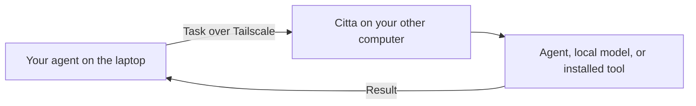

# Citta

**An agent mesh for tools, data and compute.**

Let your agents work together—and reach the capabilities each has access to. Citta lets an agent discover available workers, delegate a task, and bring the result back. A worker can use private files, installed tools, connected hardware or a local model to do its part.

The mesh runs across your own Macs and Linux machines connected through Tailscale. Set up Citta on each, then ask your agent for what you need in plain language.

> **Early release:** Start with the [installation guide](docs/install.md). Citta is for your own trusted devices; see [tested behavior and remaining limitations](docs/release-readiness.md) before relying on it for unattended work.

## Watch it work

[](https://youtu.be/EPdPu5djxSQ)

**[Watch the demo (1 minute 51 seconds)](https://youtu.be/EPdPu5djxSQ)** · [Download MP4](https://raw.githubusercontent.com/priyankark/citta/main/docs/media/citta-demo.mp4) · [Captions](docs/media/citta-demo.srt)

Two real handoffs: an agent delegates receipt analysis to a worker with access to the files, then sends categorization to a local Gemma model. The demo runs between a MacBook Air and Mac mini using synthetic receipts. Waits are shortened; later hardware examples are illustrative. Codex orchestration is cloud-backed. The film uses a work-trip scenario to demonstrate the capability; commercial use is not licensed under Citta’s [PolyForm Noncommercial terms](LICENSE.md).

## Why use it?

| Your task | What the mesh makes available |
| --- | --- |
| “Put together my trip expenses from the receipts folder.” | A worker with access to the receipts can read them and return a report. |
| “Use a local model to categorize these expenses.” | A configured model worker can run inference and return the categories. |
| “Build my hobby iPhone app and test it on my phone.” | An agent on your Mac can use its Xcode installation and connected phone. |
| “Find a worker with capacity to transcribe these recordings.” | Your agent can delegate to a worker with the transcription tools and available resources. |

The expense and local-model workflows have run between a Mac mini and MacBook Air using synthetic receipts. The hardware and transcription examples require the corresponding tools and access on the receiving device; Citta does not install them automatically.

## Why “Citta”?

**Citta** (चित्त, roughly pronounced **“chit-ta”**) is a Sanskrit word for **mind** or **thought**. The name reflects the idea behind the project: agents can bring together their available capabilities to carry out a task. The conversation stays with you while the work can happen where it makes sense.

The meaning is documented in [Lanman’s Sanskrit lexicon](https://www.sanskrit-lexicon.uni-koeln.de/scans/LANScan/LANScanpdf/lan_188.pdf); the [pronunciation](https://www.rep.routledge.com/articles/overview/indian-and-tibetan-philosophy/v-1/sections/pronunciation-of-sanskrit-words) follows the Sanskrit *c* sound, like *ch* in “church.”

## Get started

### 1. Prepare your devices

You need two of your own macOS or Linux computers, with Tailscale connected under the **same owner account**. Each computer needs Citta installed locally. Being on the network alone does not install Citta.

For the simplest agent setup, install the [Codex CLI](https://learn.chatgpt.com/docs/codex/cli) on each device that will run agent tasks. Check `codex --version`, then run `codex` once and complete sign-in. Citta needs the command-line tool available on that device; a desktop-app login alone is not the check. Citta also supports other harnesses through [manual adapters](docs/capabilities.md#agent-harness). Local model tasks need a model runtime and model installed on the receiving device.

**Know what you are enabling:** the default Codex worker can run shell commands, edit files, use the network, and use that device’s configured tools and skills, without asking for approval inside each task. It runs with your device account’s access. Set this up on computers and accounts you trust. An explicit read-only option is available in the [setup guide](docs/setup.md).

### 2. Install Citta on each device

Follow the [installation guide](docs/install.md) to choose a Mac or Linux archive, verify its checksum and install it. Binary installation needs [Python 3.11 or newer](https://www.python.org/downloads/), but no Rust compiler. The guide also covers Cargo and source builds.

Then run these commands **on each device**:

```sh
citta setup
citta doctor
```

Setup connects the devices, starts the background service, and adds Citta’s tools and skills to Codex. Open a new Codex session afterward so it loads them. If setup reports a missing login or prerequisite, fix that item and run setup again.

### 3. Ask for a small task

Start with a simple check in your agent:

> “Use Citta to find my other computer. Run a small task there and tell me which device ran it.”

Then try a task that needs the other device:

> “Use Citta to read the receipts in my trip folder on the MacBook and return an expense summary. Flag duplicates and missing receipts.”

Your agent needs the actual folder location and access on the receiving computer. Files and app logins are not automatically copied between devices.

For the reverse example, follow [use a local model on another computer](docs/local-model.md).

### 4. See what is happening

```sh
citta agents    # Devices, available resources, and agent profiles
citta tasks     # Recent tasks submitted from this device
citta panel     # A private browser link to the control panel
```

Open the link printed by `citta panel`. Visiting `localhost:7331` directly is not the panel login flow. If something is missing, start with `citta doctor` and the [troubleshooting guide](docs/install.md#troubleshooting).

## What permissions do I need?

Permissions belong to **the computer doing the work**. Give it the access needed for your intended task during setup.

| What you want to do | What the receiving computer needs |
| --- | --- |
| Run code, scripts, or tests | A signed-in agent harness, the required tools, and access to the project files |
| Use an app or connected service | That app or tool configured with the intended account |
| Click and type in Mac apps | An unlocked session and macOS Accessibility permission for the worker process |
| Capture the Mac screen | macOS Screen Recording permission for the worker process |
| Run a local model | The model runtime, downloaded model, and enough available resources |

Coding tasks do not require screen permissions. Desktop setup may also need Node and Apple command-line tools for the native helpers. Citta explains the relevant grants; verify them with a real worker task. See the [onboarding access guide](docs/setup.md#choose-what-this-device-should-do).

## How it works

1. Your agent discovers the other devices and what they can do.
2. It submits a task with the needed tools, device, or resource requirements.
3. An eligible device starts the task when it has capacity.
4. Your agent collects the result and checks it before using it.



Citta uses a local background service on each device and MCP tools for agent access. There is no required Citta cloud coordinator. Automatic enrollment is for devices owned by the same Tailscale user; arbitrary devices on a shared network do not become workers.

## A few things to know

- **Private files can be read where they live, but results travel back.** Cloud-backed agents may send task content to their model provider. Using a local model for one step does not make the whole workflow offline.
- **Citta delegates new tasks.** It does not pool RAM across computers or move a running conversation to another machine. Resource checks help choose a worker; they are not hard CPU or memory limits.
- **Tools run with the receiving account’s permissions.** Citta is intended for your trusted devices, not untrusted tenants. Desktop helpers cooperate with human activity, but full-access shell tools are not an OS sandbox.
- **An interrupted task may have already done something.** Check the result or app before repeating a send, payment, or other action. Nested tasks must be tracked and cancelled separately.
- **The core runtime targets macOS and Linux.** The included native desktop helpers are for macOS. See [tested platforms and remaining qualification](docs/release-readiness.md) before choosing a build.

## Go further

- [Install, verify, and troubleshoot](docs/install.md)
- [Setup and permissions](docs/setup.md)
- [Use a local model remotely](docs/local-model.md)
- [Connect another harness or tool](docs/capabilities.md)
- [Discovery, task placement, and MCP configuration](docs/discovery.md)
- [Upgrade, backup, and recovery](docs/operations.md)
- [Build and contribute](docs/development.md)
- [Release acceptance](docs/acceptance.md) · [Protocol](docs/protocol.md) · [Roadmap](plan.md)

## License

Citta is **source-available** under [PolyForm Noncommercial 1.0.0](LICENSE.md). Commercial use is not licensed. Personal noncommercial projects are permitted; the license also expressly permits use by charitable organizations, educational institutions, public research organizations, public safety or health organizations, environmental protection organizations, and government institutions.

When sharing any part of Citta, include the license terms or their URL and preserve the required attribution in [NOTICE](NOTICE). Third-party components retain their own licenses. Because this license restricts commercial use, Citta is not OSI open source.
