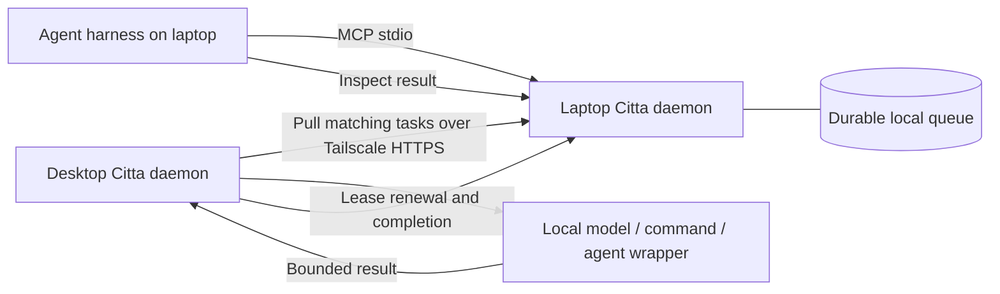

# Citta

**Let agents use capabilities and idle compute on your other devices.**

Citta is a Rust daemon for a trusted, single-owner mesh of macOS and Linux devices. An agent discovers a remote capability through MCP, submits a task, continues its work, and retrieves the result. Devices pull work when they have capacity. Each originating device keeps its own durable task queue; there is no required cloud coordinator.

Production is the delivery target. This is the first implementation undergoing qualification, with local fault tests and CI; physical device acceptance is tracked in [docs/acceptance.md](docs/acceptance.md). There is no production release tag yet.



## Included

- Automatic same-owner Tailscale enrollment, hardware telemetry, live Codex session discovery, and visibility into recent work across peers.
- Device-owned agent spawn profiles and a private browser monitoring panel with resource, agent, and failure views.
- Per-device secrets, HTTPS for remote connections, loopback-only listeners, and private state directories.
- SQLite WAL persistence, atomic claims, idempotent submission/completion, expiring leases, and replayable WebSocket events.
- Global and per-capability concurrency limits, queue limits/deadlines, execution timeouts, and bounded input/output.
- Private work directories, explicit environment allowlists, process-group cancellation, and a guardian that stops jobs when their daemon dies.
- Harness-neutral MCP tools using the official Rust MCP SDK; CLI and HTTP APIs.
- An agent setup skill, macOS/Linux service generator, and model/harness adapter examples.

## Build and run

Use Rust 1.99.1 (the CI toolchain), a C compiler for bundled SQLite/TLS, and Python 3 for helper scripts. The package declares a minimum Rust version of 1.89; that minimum is not yet a qualified toolchain.

```sh
gh repo clone priyankark/citta
cd citta
cargo build --release --locked
cargo install --path . --locked
citta init --dir "$HOME/.config/citta" --node laptop
citta --config "$HOME/.config/citta/config.toml" check
citta --config "$HOME/.config/citta/config.toml" daemon
```

Initialize using the **installed binary**, so the generated echo capability points to a stable executable. `init` creates a unique token with mode 0600 and refuses to overwrite existing configuration. All paths in the configuration are absolute. Start with the harmless `echo` capability, then install trusted capabilities deliberately.

In another terminal:

```sh
citta --config "$HOME/.config/citta/config.toml" discover
printf '%s\n' '{"message":"hello"}' | citta --config "$HOME/.config/citta/config.toml" submit --capability echo --input - --key hello-1
citta --config "$HOME/.config/citta/config.toml" tasks
citta --config "$HOME/.config/citta/config.toml" inspect TASK_UUID
```

## Connect actual devices

Follow [device setup](docs/setup.md). The setup agent enables `citta enroll` on each installed device; daemons then discover and pair automatically using the existing Tailscale account. No human pairing steps or token copying. Peers become available to workers without restarting. Existing explicit peers remain supported for staged upgrades. Remote traffic uses verified HTTPS; only numeric loopback HTTP is allowed in local tests.

No task input contains shell commands or remote executable paths. A capability maps a name to a locally configured program and fixed argument vector. JSON input arrives on stdin, and UTF-8 stdout/stderr become the result. See [capability adapters](docs/capabilities.md).

## Give an agent Citta tools

Add a stdio MCP server to the harness's existing configuration, using its supported format. The generic JSON shape is:

```json
{
  "mcpServers": {
    "citta": {
      "command": "/absolute/path/to/citta",
      "args": ["--config", "/absolute/path/to/config.toml", "mcp"]
    }
  }
}
```

Preserve other MCP servers. Citta reads its token from the private configuration; do not put tokens in MCP arguments or chat. MCP is local stdio. HTTP/WebSocket endpoints are Citta's peer protocol, not remote MCP endpoints.

Tools: `citta_agents`, `citta_spawn_agent`, `citta_discover`, `citta_activity`, `citta_submit`, `citta_inspect`, `citta_tasks`, `citta_cancel`. Submission returns immediately. `citta_inspect` and cancellation address tasks owned by the local origin. `citta_activity` also shows recent tasks owned by other devices. Reuse a submission's idempotency key on transport retries. **An interrupted task may already have produced external side effects; inspect before resubmitting.**

## Agents and human monitoring

Use `citta --config <path> agents` to see device CPU/RAM, harness-reported busy/idle sessions, and available agent profiles. `spawn-agent` starts a new bounded run using a profile installed on the receiving device. `panel` prints a short-lived local browser login link. See [discovery, spawning, and monitoring](docs/discovery.md) for configuration, freshness, compatibility, and exact limits.

## Agent setup skill

The portable skill is [skills/citta-setup/SKILL.md](skills/citta-setup/SKILL.md). For Codex, copy its directory into `~/.codex/skills/` without overwriting a customized existing copy. Other harnesses can load the same instructions through their skill mechanism. Ask the agent: “Use the citta-setup skill to enroll this device and verify remote delegation.”

## Verify

```sh
cargo fmt --check
cargo clippy --locked --all-targets -- -D warnings
cargo test --locked
cargo build --locked
python3 scripts/test_mesh.py
python3 scripts/test_helpers.py
python3 scripts/test_ci_health.py
cargo audit
```

The mesh suite uses two real daemon processes with separate secrets, databases, and capability sets. It exercises remote-only execution, MCP submission, capacity, cancellation, timeouts, queue expiry, restart, lease loss, and hard worker death. It needs no accounts or model downloads. CI runs on macOS and Linux and retains release binaries as test artifacts; these are not automatically published releases.

Read [the plan](plan.md), [protocol](docs/protocol.md), [operations](docs/operations.md), and [release acceptance](docs/acceptance.md) for exact guarantees and remaining qualification.

Refresh and inspect CI history with `python3 scripts/ci_health.py`; see [build health](docs/build-health.md). Planned task permissions, MXC sandboxing, allow-all behavior, and the product failure inbox are described in [the plan](plan.md#device-owned-permissions-and-unattended-execution). These controls are not yet implemented in the daemon.
