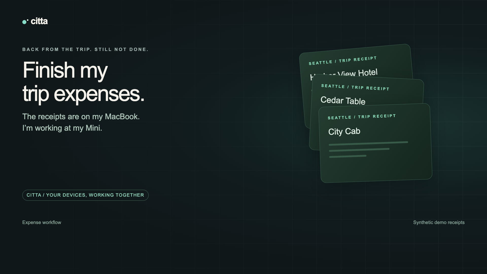
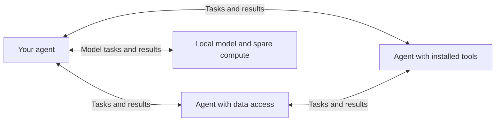

# Citta

**A network for agents to share tools, data and compute.**

[Website](https://citta-kappa.vercel.app) · [Install](docs/install.md) · [First task](docs/first-task.md)

Citta connects your AI agents into a private network, so they can use each other's tools, access data and put spare compute to work.

Each agent brings what it has access to: private files, installed tools, local models or connected hardware. An agent can find what is available on the network, send work to a suitable member and get the result back.

The network runs on your own Macs and Linux machines connected through Tailscale. They can be on the same local network or in different locations. Install Citta on each, set up the tools and access you want to use, then ask your agent for what you need.

> **0.1.0 is available:** [Mac and Linux installers](https://github.com/priyankark/citta/releases/tag/v0.1.0) · [Cargo crate](https://crates.io/crates/citta/0.1.0) · [Installation guide](docs/install.md) · [Run your first task](docs/first-task.md). This is an early release for your own trusted devices; see [tested behavior and remaining limitations](docs/release-readiness.md) before relying on it for unattended work.

## Watch it work

[](https://youtu.be/EPdPu5djxSQ)

**[Watch the demo (1 minute 51 seconds)](https://youtu.be/EPdPu5djxSQ)** · [Download MP4](https://raw.githubusercontent.com/priyankark/citta/main/docs/media/citta-demo.mp4) · [Captions](docs/media/citta-demo.srt)

The network in action: one agent reads receipt files for another, then a local Gemma model supplies expense categories. The demo runs between a MacBook Air and Mac mini using synthetic receipts. Waits are shortened; later hardware examples are illustrative. Codex orchestration is cloud-backed. The film uses a work-trip scenario to demonstrate the capability; commercial use is not licensed under Citta’s [PolyForm Noncommercial terms](LICENSE.md).

## Why use it?

| Your task | What the agent network makes available |
| --- | --- |
| “Put together my trip expenses from the receipts folder.” | An agent with access to the receipts can read them and return a report. |
| “Use a local model to categorize these expenses.” | A member of the network with the model installed can run it and return the categories. |
| “Build my hobby iPhone app and test it on my phone.” | An agent on your Mac can use its Xcode installation and connected phone. |
| “Find somewhere on the network to transcribe these recordings.” | An agent with the transcription tools and enough available compute can take the task. |

The expense and local-model workflows have run between a Mac mini and MacBook Air using synthetic receipts. The hardware and transcription examples require the corresponding tools and access on the receiving device; Citta does not install them automatically.

## Why “Citta”?

**Citta** (चित्त, roughly pronounced **“chit-ta”**) is a Sanskrit word for **mind** or **thought**. The name reflects the idea behind the project: a network of agents can bring their tools, data and compute together to get work done.

The meaning is documented in [Lanman’s Sanskrit lexicon](https://www.sanskrit-lexicon.uni-koeln.de/scans/LANScan/LANScanpdf/lan_188.pdf); the [pronunciation](https://www.rep.routledge.com/articles/overview/indian-and-tibetan-philosophy/v-1/sections/pronunciation-of-sanskrit-words) follows the Sanskrit *c* sound, like *ch* in “church.”

## Get started

### 1. Prepare your devices

You need two of your own macOS or Linux computers, with Tailscale connected under the **same owner account**. Each computer needs Citta installed locally. Being on the network alone does not install Citta.

For the simplest agent setup, install the [Codex CLI](https://learn.chatgpt.com/docs/codex/cli) on each device that will run agent tasks. Check `codex --version`, then run `codex` once and complete sign-in. Citta needs the command-line tool available on that device; a desktop-app login alone is not the check. Citta also supports other harnesses through [manual adapters](docs/capabilities.md#agent-harness). Local model tasks need a model runtime and model installed on the receiving device.

**Know what you are enabling:** the default Codex worker can run shell commands, edit files, use the network, and use that device’s configured tools and skills, without asking for approval inside each task. It runs with your device account’s access. Set this up on computers and accounts you trust. An explicit read-only option is available in the [setup guide](docs/setup.md).

### 2. Install Citta on each device

Follow the [installation guide](docs/install.md) to choose a Mac or Linux archive, verify its checksum and install it. Binary installation needs [Python 3.11 or newer](https://www.python.org/downloads/), but no Rust compiler. The guide also covers Cargo and source builds.

Then run these commands **on each device**:

```sh
citta setup
citta doctor
```

Setup connects the devices, starts the background service, and adds Citta’s tools and skills to Codex. Open a new Codex session afterward so it loads them. If setup reports a missing login or prerequisite, fix that item and run setup again.

### 3. Ask for a small task

Start with a simple check in your agent:

> “Use Citta to find what is available on my agent network. Send a small task to another member and tell me where it ran.”

Then try a task that needs the other device:

> “Use Citta to read the receipts in my trip folder on the MacBook and return an expense summary. Flag duplicates and missing receipts.”

Your agent needs the actual folder location and access on the receiving computer. Files and app logins are not automatically copied between devices.

For the reverse example, follow [use a local model on another computer](docs/local-model.md).

### 4. See what is happening

```sh
citta agents    # Devices, available resources, and agent profiles
citta tasks     # Recent tasks submitted from this device
citta panel     # A private browser link to the control panel
```

Open the link printed by `citta panel`. Visiting `localhost:7331` directly is not the panel login flow. If something is missing, start with `citta doctor` and the [troubleshooting guide](docs/install.md#troubleshooting).

## What permissions do I need?

Permissions belong to **the computer doing the work**. Give it the access needed for your intended task during setup.

| What you want to do | What the receiving computer needs |
| --- | --- |
| Run code, scripts, or tests | A signed-in agent harness, the required tools, and access to the project files |
| Use an app or connected service | That app or tool configured with the intended account |
| Click and type in Mac apps | An unlocked session and macOS Accessibility permission for the worker process |
| Capture the Mac screen | macOS Screen Recording permission for the worker process |
| Run a local model | The model runtime, downloaded model, and enough available resources |

Coding tasks do not require screen permissions. Desktop setup may also need Node and Apple command-line tools for the native helpers. Citta explains the relevant grants; verify them with a real worker task. See the [onboarding access guide](docs/setup.md#choose-what-this-device-should-do).

## How it works

1. Your agent discovers the members of the network and what each can do.
2. It submits a task with the needed tools, device, or resource requirements.
3. An eligible device starts the task when it has capacity.
4. Your agent collects the result and checks it before using it.



Citta uses a local background service on each device and MCP tools for agent access. There is no required Citta cloud coordinator. Automatic enrollment is for devices owned by the same Tailscale user; arbitrary devices on a shared network do not become workers.

## A few things to know

- **Private files can be read where they live, but results travel back.** Cloud-backed agents may send task content to their model provider. Using a local model for one step does not make the whole workflow offline.
- **Compute and memory are used where the task runs.** An agent can send a new task to a network member with enough CPU and RAM. Citta does not combine RAM into one pool or move a running conversation. Resource checks help choose where a task runs; they are not hard CPU or memory limits.
- **Tools run with the receiving account’s permissions.** Citta is intended for your trusted devices, not untrusted tenants. Desktop helpers cooperate with human activity, but full-access shell tools are not an OS sandbox.
- **An interrupted task may have already done something.** Check the result or app before repeating a send, payment, or other action. Nested tasks must be tracked and cancelled separately.
- **The core runtime targets macOS and Linux.** The included native desktop helpers are for macOS. See [tested platforms and remaining qualification](docs/release-readiness.md) before choosing a build.

## Tried it?

[Get setup help](https://github.com/priyankark/citta/issues/new?template=setup.yml) or [tell us how your first task went](https://github.com/priyankark/citta/issues/new?template=first-task.yml). A short report about what worked or where you got stuck helps us improve Citta.

## Go further

- [Install, verify, and troubleshoot](docs/install.md)
- [Setup and permissions](docs/setup.md)
- [Use a local model remotely](docs/local-model.md)
- [Connect another harness or tool](docs/capabilities.md)
- [Discovery, task placement, and MCP configuration](docs/discovery.md)
- [Upgrade, backup, and recovery](docs/operations.md)
- [Build and contribute](docs/development.md)
- [Release acceptance](docs/acceptance.md) · [Protocol](docs/protocol.md) · [Roadmap](plan.md)

## License

Citta is **source-available** under [PolyForm Noncommercial 1.0.0](LICENSE.md). Commercial use is not licensed. Personal noncommercial projects are permitted; the license also expressly permits use by charitable organizations, educational institutions, public research organizations, public safety or health organizations, environmental protection organizations, and government institutions.

When sharing any part of Citta, include the license terms or their URL and preserve the required attribution in [NOTICE](NOTICE). Third-party components retain their own licenses. Because this license restricts commercial use, Citta is not OSI open source.
